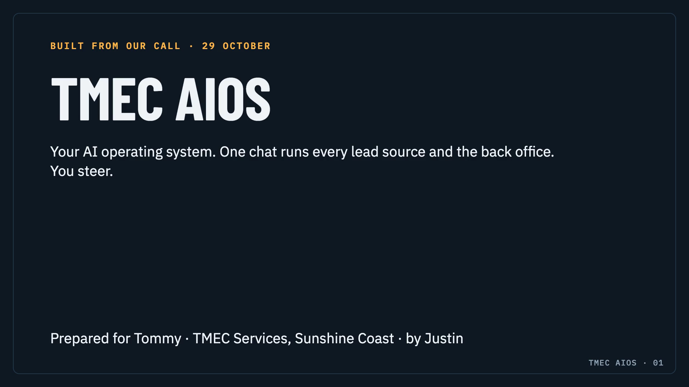

# TMEC AIOS: a taste of what's coming

G'day Tommy. This is a small slice of your AI operating system, so you can feel what it's like before we install the real one together.

The real system (version 1 is built, and we install it with you in Session 2) has one chat you talk to, the **Chief of Staff**, and nine specialists behind it. This preview is that same chat, working on real sample data we pulled for TMEC: real people in Queensland asking about solar and batteries, and a starter list of Sunshine Coast trades who could send you customers.

**Nothing in here can send, post or spend anything.** It only reads the sample files and writes drafts inside this folder.

## Two ways to try it

### 1. Just read it

Open [A-MORNING-WITH-YOUR-AIOS.md](A-MORNING-WITH-YOUR-AIOS.md) right here. It's what a normal morning looks like once the system is running.

### 2. Talk to it (if you have Claude)

1. Get the folder. Easiest: open the Claude desktop app, go to the **Code** tab, and say *"clone https://github.com/jbellsolutions/tmec-aios-preview to my Desktop and open it"*. Or on this page click the green **Code** button, then **Download ZIP**, and unzip it.
2. In the Claude desktop app's **Code** tab, choose the `tmec-aios-preview` folder. (Claude Code comes with Claude's paid plans. No Claude yet? No worries, we set it up together in Session 2.)
3. Say **"good morning"**, or try one of these:

| Say or type | What happens |
|---|---|
| `good morning` or `/morning` | Your morning brief from the sample: what came in, and a short yes/no list |
| `/radar` | Reads the real Reddit sample, picks the best Queensland buyers, and drafts a helpful reply to each in TMEC's voice |
| `/partner` | Picks a Sunshine Coast trade from the starter list and drafts your first hello, plus the email they'd send their own customers |
| `/quiet-quotes` | Drafts the right follow-up for each quote that went quiet, sorted by why it stalled (made-up practice quotes) |
| `/big-list` | Interviews you for Tuesday's big list, one question at a time, and saves your answers in your words |

Talk to it like a person. With Wispr Flow you can just speak. Drafts land in `drafts/`, and the day's note goes in `vault/` (you can open that folder in Obsidian).

**Best use of it before Tuesday:** run `/big-list` and bring `vault/big-list.md` (or drop it in our Slack channel). Then we spend Session 1 building, not remembering.

## What's in here

| Folder or file | What |
|---|---|
| [A-MORNING-WITH-YOUR-AIOS.md](A-MORNING-WITH-YOUR-AIOS.md) | A morning with the full system, start to finish |
| [WHATS-COMING.md](WHATS-COMING.md) | What the full system adds, and what switches on in order |
| `CLAUDE.md` | The preview Chief of Staff's instructions |
| `.claude/commands/` | The five things you can ask for by name |
| `sample-data/` | The real radar sample, the real starter partner list, made-up quiet quotes for practice, the rebate facts we use, and TMEC's voice |
| `drafts/` | Where your drafts land |
| `vault/` | The memory: a note for each day, and your big list |

## Good to know

- **It's a preview.** Sample data, no connections, nothing sent. The full system connects to HubSpot, your ads, your email and Alfred, and still sends nothing without your yes.
- **Ask it anything.** If you ask for something the preview can't do, it tells you whether the full system covers it and adds your idea to your big list.
- **Questions?** Ask in our Slack channel.

Built by Justin · Everyone Needs an AI Guy
